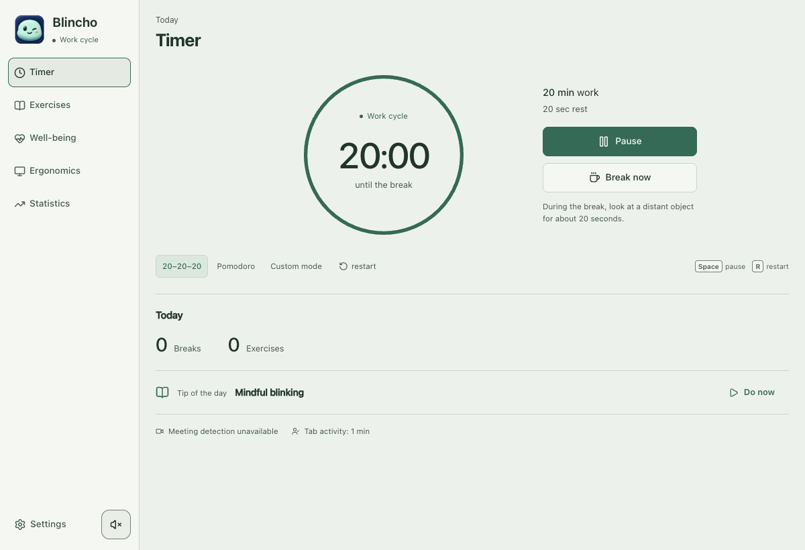

<p align="center">
  <a href="https://blincho.app">
    
  </a>
</p>

<h1 align="center">Blincho</h1>

<p align="center">
  <strong>Small breaks. A calmer day at your screen.</strong><br>
  A free, open-source screen-break companion for macOS, Windows and Linux.
</p>

<p align="center">
  <a href="https://blincho.app/#download"><strong>Download Blincho</strong></a> ·
  <a href="https://blincho.app">Website</a> ·
  <a href="https://github.com/WonderMr/blincho/releases">Releases</a> ·
  <a href="#development">Contribute</a>
</p>

<p align="center">Every feature is free · No account required · 30 languages · MIT licensed</p>

[](https://github.com/WonderMr/blincho/actions/workflows/ci.yml?query=branch%3Amain+event%3Apush)
[](https://github.com/WonderMr/blincho/actions/workflows/vulnerability-scan.yml?query=branch%3Amain+event%3Apush)

Blincho reminds you to step away from the screen, rest your eyes and move a little. Set your rhythm, let the timer handle the reminders, and keep your journal and statistics on your own device.

<picture>
  <source media="(prefers-color-scheme: dark)" srcset="docs/images/blincho-dark.png">
  
</picture>

<p align="center"><sub>The shared app interface, shown in the browser build. Light and dark themes follow your GitHub theme.</sub></p>

## Make room for a break

| Your day | How Blincho helps |
| --- | --- |
| **Long stretches at the screen** | Configurable work and break intervals, including the 20–20–20 rule. |
| **Stepping away from your desk** | Desktop timing pauses during absence, screen lock and sleep. |
| **Calls that run over** | Optional call detection and meeting controls help you postpone breaks until a better moment. |
| **A moment to move** | Short exercises and a personal comfort journal. |
| **Understanding your habits** | Local work-time statistics, break counts and daily activity history. |
| **Making it feel like yours** | 30 languages, light/dark/system themes and calming color palettes. |

The desktop timer keeps running when the window is hidden or minimized. Optional camera presence checks, input activity counts, call history and a local MCP connection are available in Settings. Camera features, input statistics, call history and Local MCP are off by default.

At first camera opt-in, Blincho downloads an approximately 19 MB person-detection model from a pinned commit in WonderMr/blincho on GitHub. It verifies every file's size and SHA-256, then caches the complete model locally in IndexedDB. Later camera checks work offline. A failed or cancelled download leaves the option off so it can be retried. Clearing application storage can remove the cache. GitHub receives ordinary download request metadata; camera frames stay on the device and are never stored or uploaded.

[Explore all features, platform support and optional permissions →](docs/FEATURES.md)

## Get started

1. **[Download the package for your computer](https://blincho.app/#download).** Choose macOS, Windows or Linux and the matching architecture.
2. **Set your rhythm.** Use the default 20-minute work cycle and 20-second break, or choose your own intervals.
3. **Take a pause when reminded.** Look away from the screen or try a short exercise. Your statistics stay on your device.

The download page lists signing and update support for each package. Unsigned packages may show an operating-system publisher warning. Current desktop packages use manual download and installation for updates.

Blincho is a general wellness tool. It does not diagnose or treat eye conditions. Windows and Linux lock/sleep behavior has automated coverage but has not yet been validated on physical hardware.

## Your data stays with you

Settings, journal answers and statistics remain on the device. Unless background update checks are turned off, packages contact `blincho.app` for update metadata. Downloads come from GitHub. These requests do not send journal answers or activity history. No account is required.

- **Camera checks run locally.** Frames are never saved or uploaded, and the camera turns off after each check.
- **Optional tracking has separate controls.** Input statistics count events without recording typed text. Call history stores observed times and normalized application names, without conversation content.
- **Local MCP is opt-in.** It binds to `127.0.0.1` and shares settings and daily aggregate totals. Detailed activity/call history, journal answers and camera frames are excluded.

[Local MCP setup and API reference →](docs/LOCAL_MCP.md)

<details>
<summary><strong>Call history and migration from older versions</strong></summary>

The tray shows the current detected call and its application while either call feature is enabled. This transient status does not enable recording. Call history is off by default and has its own switch, separate from postponing breaks during calls. It stores only observed times and normalized application names locally, without conversation content, audio, participants, meeting titles or URLs. Turn recording off to stop future records, or delete call history from Statistics while keeping your other local history.

The application identity remains `com.myeyes.app`. Legacy Electron releases used the `myeyes` profile. On the first Tauri desktop launch, Blincho imports settings, journal answers and statistics from a private copy of that profile into the system WebView storage. It does not change the original Electron database or overwrite an existing Tauri profile. Quit the old Electron app before the first migration so its database is stable. Windows paths that cannot be represented in the legacy LevelDB encoding require an available short path; otherwise the app shows the history recovery screen without modifying the source. Later launches use the migrated profile without importing it again.

If history migration fails, a localized recovery screen appears before the app creates settings or history. Close the old Electron app and choose Retry after correcting the source. Continue without history records an explicit choice for this Tauri profile and allows new local records; later launches do not attempt the legacy import. The original Electron database remains unchanged.

</details>

## Development

The desktop app uses **Tauri 2 + Rust** with the system WebView. **React + TypeScript** power the shared desktop and browser interface.

Use Node.js 22.12 or newer, plus the [native prerequisites for your OS](docs/DEVELOPMENT.md).

```sh
git clone https://github.com/WonderMr/blincho.git
cd blincho
npm ci
npm start
```

Use `npm run dev` for the browser UI. The browser build sees activity only within its own page and pauses when hidden; system-wide activity, lock and sleep detection require the desktop app.

Before proposing a change:

```sh
npm test
npm run build
npm run site:build
```

[Builds and native tests](docs/DEVELOPMENT.md) · [CI and security checks](docs/DEVELOPMENT.md#checks) · [Release pipeline](RELEASE.md) · [Changelog](CHANGELOG.md)

### Separate test channel

The `test` branch is the integration target for experimental work. Pull requests targeting it and pushes to it run **Build isolated test apps**, which retains portable downloads for 14 days in the Actions run. This workflow does not publish releases, update feeds or the website. It builds macOS ARM64/Intel, Windows x64 and Linux x64 packages.

Run `npm run tauri:build:test` locally, optionally passing the matching native Rust target after `--`. Downloads and SHA-256 checksums go to `release/test-artifacts/`. Open `Blincho Test.app`, `Blincho Test.exe` or the extracted executable AppImage directly. Windows needs WebView2. These portable packages do not require replacing the installed application. macOS test packages have an ad-hoc signature without notarization.

`Blincho Test` uses the separate identity `com.myeyes.test`, its own application data and WebView storage, and its own singleton. It can run alongside Blincho. It does not import stable history or preferences, register login startup, create desktop shortcuts or handle `.blincho` files. Stable update checks are disabled. Update it by downloading another test artifact. Sync remains off by default. Windows notifications may register their own `Blincho Test` Start Menu shortcut. Local MCP uses an OS-assigned port in this channel. Use a separate test account for cloud isolation. Signing into the same account intentionally shares settings, statistics and breaks. The profile is retained across test builds; restart still requires reconnecting the account with its encryption key. Both applications retain their own timers, so pause one before manually testing breaks in the other.

### Experimental account sync

Experimental device synchronization is off by default in Settings. Enabling it reveals an invite-only account connection for the self-hosted service at `back.blincho.app`. Use an email/password account and the same separately saved encryption key on every device. The app keeps its session and encryption key in memory, so reconnect after restarting. The service cannot recover a lost encryption key. This feature is a testing implementation; deployment and validation on physical devices are still required before relying on it.

Only timer rhythm, sound, appearance and daily aggregate statistics synchronize. Journal answers, detailed activity, calls, input counters and camera frames remain local. Each installation uploads its own aggregate snapshot; the combined display sums device use, including overlapping use, and does not replace local history. Backed-up profiles cloned to another device share an installation identity and should not both upload the same imported history. Device privacy permissions, camera, strict mode, call handling, notifications and local MCP opt-ins stay local. Remote settings use the latest accepted server revision; simultaneous local changes retry against that revision.

An online connected device can schedule a shared blocking Blincho break 2.5 seconds ahead. Peers poll every second, validate the encrypted command and use its remaining duration. Calls and absence can skip a remote break, offline devices continue their local timer, and connection errors never prevent a local break. This is best-effort coordination with synchronized system clocks; browser throttling, sleep and network delays prevent a guarantee of simultaneous delivery. It does not remotely lock the operating system. A shared break uses the local strict overlay until its deadline, without changing the saved strict-mode preference. Logout cancels pending commands. Account deletion removes active cloud data; local records remain.

The compatible backend and its operator documentation are maintained separately. The server stores ciphertext plus account/session metadata. Password reset, email verification, encryption-key rotation and per-device session management are outside this first test version. Frontend tests use a disposable protocol fixture; with the private backend checked out, run `BLINCHO_BACKEND_SOURCE=/absolute/path/to/backend/server.cjs node --test tests/accountSync.test.cjs` for real client/server integration.

## Contributing

Open an issue with your OS, app version and reproduction steps. Do not include personal journal entries or secrets. Run tests and the build before proposing changes. User-facing text must follow [AGENTS.md](AGENTS.md), including the punctuation rule in every language.

MIT licensed. See [LICENSE](LICENSE).
